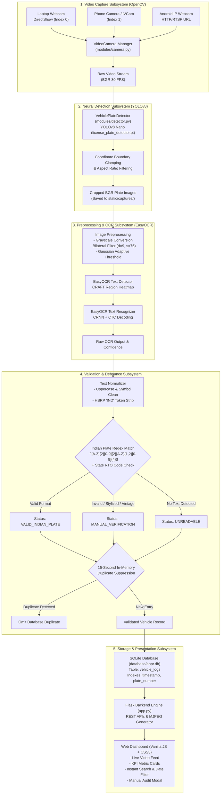
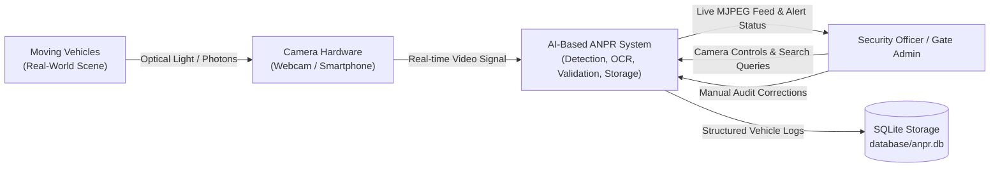
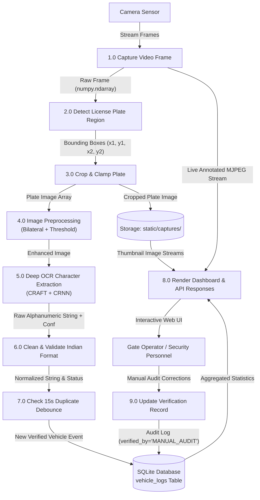
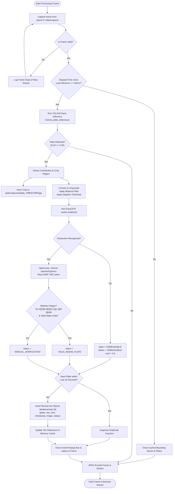
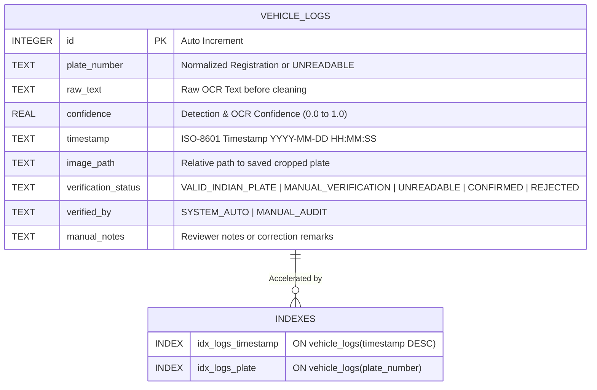
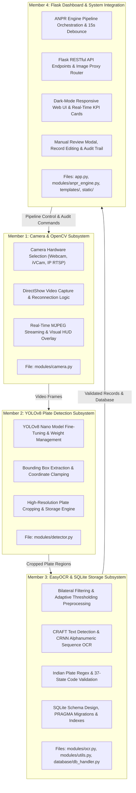

# AI-Based Automatic Number Plate Recognition (ANPR)
## System Architecture, Data Flow, and Design Diagrams

This document contains architectural blueprints, data flow diagrams (DFD Level 0 and Level 1), algorithm processing flowcharts, database entity-relationship models, and four-member module distribution mappings representing the system.

---

## 1. Overall System Architecture Diagram



---

## 2. Data Flow Diagrams (DFD)

### DFD Level 0 (Context Diagram)

The Level 0 context diagram depicts the external entities interacting with the ANPR system boundary:



---

### DFD Level 1 (Detailed Subsystem Data Flow)

The Level 1 diagram breaks down internal data stores and transformation processes:



---

## 3. ANPR Processing Pipeline Flowchart

Detailed algorithmic execution path per video frame:



---

## 4. SQLite Database Design & Entity-Relationship Model



### Table Definition SQL
```sql
CREATE TABLE IF NOT EXISTS vehicle_logs (
    id INTEGER PRIMARY KEY AUTOINCREMENT,
    plate_number TEXT NOT NULL,
    raw_text TEXT DEFAULT '',
    confidence REAL NOT NULL,
    timestamp TEXT NOT NULL,
    image_path TEXT DEFAULT '',
    verification_status TEXT DEFAULT 'VALID_INDIAN_PLATE',
    verified_by TEXT DEFAULT 'SYSTEM_AUTO',
    manual_notes TEXT DEFAULT ''
);

CREATE INDEX IF NOT EXISTS idx_logs_timestamp ON vehicle_logs(timestamp);
CREATE INDEX IF NOT EXISTS idx_logs_plate ON vehicle_logs(plate_number);
```

---

## 5. Four-Member Module Distribution Diagram


