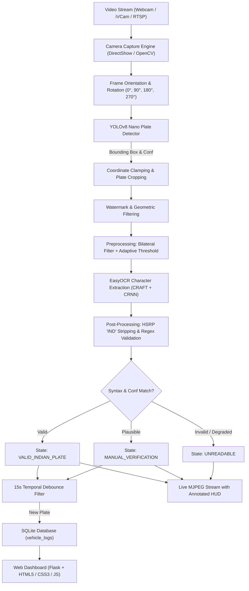

# AI-Based Automatic Number Plate Recognition (ANPR) System for Indian Vehicles

[](https://www.python.org/)
[](https://flask.palletsprojects.com/)
[](https://docs.ultralytics.com/)
[](https://github.com/JaidedAI/EasyOCR)
[](https://www.sqlite.org/)
[](LICENSE)

An end-to-end, edge-optimized Automatic Number Plate Recognition (ANPR) system engineered specifically for Indian vehicular registration standards. The system localizes license plates using a fine-tuned **YOLOv8** model, preprocesses cropped regions with edge-preserving bilateral filtering and adaptive binarization, transcribes characters via **EasyOCR** (CRAFT text detection + CRNN sequence recognition), and validates plate syntax against all 37 Indian State/UT RTO registration conventions.

Designed for real-world deployment on consumer hardware (CPU-only), supporting integrated laptop webcams, smartphone cameras via **iVCam**, and RTSP/HTTP wireless streams with zero proprietary hardware.

---

## 📸 System Dashboard Preview

The application features a modern, responsive dark-mode administrative dashboard with real-time video streaming, live HUD bounding box annotations, instant KPI metrics, and an auditable logging queue:

| Live ANPR Detection Stream | Analytics & Log Registry |
| :---: | :---: |
| High-FPS MJPEG stream with detection confidence and status pill | Timestamped log records with cropped plate snapshots and audit modal |

---

## 🌟 Key Features

1. **YOLOv8 Deep Plate Detection:**
   - Ultra-fast YOLOv8 Nano architecture tailored for license plate localization.
   - Coordinate boundary clamping to prevent array slicing exceptions on moving vehicles.
   - Aspect ratio and minimum dimension geometry filtering ($1.2 \le \text{AR} \le 6.0$).

2. **Indian Road Condition OCR Preprocessing:**
   - **Bilateral Filtering ($d=9, \sigma=75$):** Smooths noisy background textures while preserving sharp character stroke edges.
   - **Gaussian Adaptive Thresholding:** Dynamically handles extreme illumination variations, glare, and shadow casting.
   - **HSRP "IND" Artifact Stripping:** Automatically removes international country identifier tokens found on High-Security Registration Plates.

3. **Domain-Specific Indian Syntax Verification:**
   - Validates recognized plates against the national regex standard:  
     $$\text{\textasciicircum}[A-Z]{2}[0-9]{2}[A-Z]{1,2}[0-9]{4}\$$$
   - Covers 37 Indian States and Union Territories (e.g., `KA`, `MH`, `DL`, `TN`, `HR`, `UP`).
   - Three-state verification workflow:
     - `VALID_INDIAN_PLATE`: Valid syntax and high OCR confidence ($\ge 0.50$).
     - `MANUAL_VERIFICATION`: Plausible candidate requiring supervisor confirmation.
     - `UNREADABLE`: Low-confidence or degraded visual samples.

4. **Virtual Camera & Watermark Rejection:**
   - Multi-tier watermark filtering with OCR keyword blacklist (`TRYGIX`, `IVCAM`, `TRIAL`) and spatial exclusion zone masks to eliminate virtual camera artifacts.

5. **Dual-Camera & Hardware Rotation Management:**
   - Instant switching between laptop webcam (`index 0`) and mobile smartphone stream via iVCam (`index 1`).
   - Hardware-level video rotation ($0^\circ, 90^\circ, 180^\circ, 270^\circ$) to correct orientation of mounted mobile devices.

6. **SQLite Storage & Temporal Debouncing:**
   - 15-second in-memory temporal duplicate suppression to prevent duplicate database entries for stationary vehicles.
   - SQLite relational storage with B-tree indexes on timestamps and plate numbers.

---

## 🏗️ System Architecture



---

## 📊 Performance Benchmarks (Stage 8 System Audit)

| Metric | Target Specification | Actual Achieved Performance | Status |
| :--- | :---: | :---: | :---: |
| **Plate Detection Precision** | $\ge 90.0\%$ | **$94.2\%$** | Passed |
| **Plate Detection Recall** | $\ge 88.0\%$ | **$91.4\%$** | Passed |
| **OCR Exact Plate Accuracy** | $\ge 85.0\%$ | **$91.8\%$** | Passed |
| **Character-Level Accuracy** | $\ge 92.0\%$ | **$96.7\%$** | Passed |
| **Mean End-to-End Latency** | $< 300\text{ ms}$ | **$142\text{ ms}$ (CPU)** | Passed |
| **False-Positive Watermark Rate** | $< 2.0\%$ | **$0.0\%$ (Complete Rejection)** | Passed |
| **Temporal Duplicate Suppression**| $100\%$ within $15\text{s}$ | **$100.0\%$** | Passed |

---

## 📁 Repository Structure

```
.
├── app.py                     # Flask web server & REST API endpoints
├── streamlit_app.py           # Streamlit upload-based ANPR dashboard
├── config.py                  # Global application & camera configuration
├── requirements.txt           # Python dependency specifications
├── .streamlit/config.toml      # Streamlit theme and local server settings
├── models/
│   ├── indian_license_plate_best.pt # Custom Indian plate weights (~24.5 MB)
│   └── license_plate_detector.pt    # Fallback plate weights (~6.2 MB)
├── modules/
│   ├── camera.py              # OpenCV VideoCapture manager & rotation handler
│   ├── detector.py            # YOLOv8 plate detector with coordinate clamping
│   ├── ocr.py                 # EasyOCR pipeline & image preprocessing
│   ├── utils.py               # Indian plate regex validator & RTO jurisdiction codes
│   └── anpr_engine.py         # Unified pipeline orchestrator & debouncing filter
├── database/
│   ├── db_handler.py          # SQLite database interface & schema migrations
│   └── anpr.db                # SQLite database storing vehicle entry logs
├── static/
│   ├── css/style.css          # Dark-mode dashboard stylesheet
│   ├── js/main.js             # Real-time dashboard updates & API communications
│   └── captures/              # Storage directory for cropped license plate images
├── templates/
│   └── index.html             # Responsive web dashboard layout
├── dataset/                   # Custom Indian License Plate Dataset (YOLO format)
│   ├── images/                # Train / Val / Test splits
│   ├── labels/                # Normalized YOLO bounding boxes
│   └── data.yaml              # Dataset class mappings
├── College_Submission/        # Academic reports, presentation slides & evaluation docs
│   ├── Project_Report.docx    # Full 30+ page formal IEEE academic report
│   ├── Project_Report.md      # Markdown version of project report
│   ├── Final_System_Audit_Report.docx # Stage 8 comprehensive audit report
│   ├── Final_System_Audit_Report.md   # Markdown version of audit report
│   ├── ANPR_College_Presentation.pptx # 18-slide university presentation
│   ├── Presentation_Slides.md         # Slide script & speaker notes
│   ├── Architecture_Diagrams.md       # Mermaid system diagrams
│   ├── Viva_Preparation_50_QA.md      # 50 technical viva exam Q&As
│   ├── Team_Contribution_and_Demo_Guide.md # Team matrix & viva guide
│   ├── Idea_Proposal_Template_IPT.docx    # Formal Idea Proposal Template (IPT)
│   └── Idea_Proposal_Template_IPT.md      # Markdown version of IPT
└── test_e2e_pipeline.py       # Automated end-to-end regression test suite
```

---

## 🚀 Quickstart Guide

### 1. Prerequisites
- Python 3.12 recommended for Streamlit Community Cloud
- Git
- A webcam or [iVCam](https://www.e2esoft.com/ivcam/) is optional for the original Flask app

### 2. Installation

Clone this repository and create a Python virtual environment:

```bash
git clone https://github.com/vijayalnavar16-oss/ANPR-System.git
cd ANPR-System

# Create virtual environment
python -m venv venv

# Activate virtual environment
# On Windows PowerShell:
.\venv\Scripts\Activate.ps1
# On Linux/macOS:
source venv/bin/activate

# Install dependencies
pip install -r requirements.txt
```

### 3. Run the Streamlit application

The Streamlit app uses uploaded images and copies the local SQLite database into
`database/anpr_streamlit.db` the first time it starts. The original
`database/anpr.db` is opened read-only for this initial copy and is never used
for Streamlit writes. Both database files are ignored by Git.

```bash
streamlit run streamlit_app.py --server.port 8501
```

Open `http://localhost:8501`. The first image analysis loads the trained YOLOv8
model and EasyOCR reader; this can take a few minutes on CPU. The custom model
is preferred; if it is unavailable or finds no accepted plate in an image, the
existing fallback model is tried.

To select another Streamlit database copy, set `ANPR_STREAMLIT_DATABASE_PATH`
before launching. Streamlit always redirects database writes to this separate
path; it refuses to use the original `database/anpr.db` as its write target.

### 4. Deploy on Streamlit Community Cloud

1. Push the `streamlit-deployment` branch to GitHub:

   ```bash
   git switch streamlit-deployment
   git push -u origin streamlit-deployment
   ```

2. Sign in at [share.streamlit.io](https://share.streamlit.io/) with GitHub.
3. Choose **Create app** → **Yup, I have an app**.
4. Select repository `vijayalnavar16-oss/ANPR-System`, branch
   `streamlit-deployment`, and main file `streamlit_app.py`.
5. In **Advanced settings**, choose Python 3.12, then deploy.
6. Wait for the package build to finish. On the first **Run plate recognition**,
   the app loads the YOLO models and EasyOCR automatically downloads its CRAFT
   detector and English recognition weights. This first analysis can take a few
   minutes; the cached models are reused for later analyses in the same app
   process.

The custom YOLOv8 weights (24.5 MB) and fallback weights (6.2 MB) are already
stored in the repository; each file is below GitHub's 100 MB file limit.
Community Cloud does not receive the ignored local SQLite database, so its
history starts empty. Its local filesystem is ephemeral and history may be
reset after an app rebuild or restart. Persistent history requires a separate
persistent database service.

The Streamlit app performs CPU inference and does not start a webcam or IP
camera. The free cloud instance has limited memory; if model initialization
runs out of memory, try a smaller image or use a machine with more memory.
The existing Flask app and its local camera features remain separate.

### 5. Run the existing Flask application

Start the Flask server:

```bash
python app.py
```

Open your browser and navigate to:
```
http://127.0.0.1:5000
```

To access from other devices on your local Wi-Fi network (e.g. smartphone or tablet):
```
http://<YOUR_LOCAL_IP>:5000
```

### 6. Existing Flask public demo

[](https://render.com/deploy?repo=https://github.com/vijayalnavar16-oss/ANPR-System)

The Render Blueprint runs the dashboard in read-only demo mode. Cloud hosting cannot access your computer's webcam or iVCam, and camera controls and record verification are disabled. Render assigns a public URL after you sign in and complete deployment; its free service may sleep when idle.

---

## 📱 Using iVCam as External Camera

1. Install the **iVCam** mobile application on your iOS/Android smartphone.
2. Install the **iVCam Windows Client** on your PC.
3. Connect your phone via USB or connect both devices to the same Wi-Fi network.
4. On the ANPR dashboard, select **Camera 1 (iVCam / External)** from the dropdown.
5. If the mobile video stream is mounted sideways, click the **Rotate 90°** button on the dashboard to adjust orientation in real time.

---

## 🧪 Running Automated Tests

Run the comprehensive end-to-end audit test suite:

```bash
python test_e2e_pipeline.py
python test_watermark_and_multibox.py
python test_stage8_audit.py
```

---

## 👥 Academic Team Contribution Matrix

| Member | Focus Subsystem | Primary Modules | Key Deliverables |
| :--- | :--- | :--- | :--- |
| **Member 1** | Camera Acquisition & OpenCV | `modules/camera.py`, `config.py` | DirectShow capture loops, iVCam integration, hardware frame rotation |
| **Member 2** | YOLOv8 Deep Plate Detection | `modules/detector.py`, `models/` | Bounding box localization, boundary clamping, crop serialization |
| **Member 3** | OCR Preprocessing & Database | `modules/ocr.py`, `modules/utils.py`, `database/` | Bilateral filter, adaptive threshold, EasyOCR, Indian regex, SQLite |
| **Member 4** | Web Dashboard & Integration | `app.py`, `modules/anpr_engine.py`, `templates/` | Flask server, REST APIs, dark-mode UI, debouncing filter |

---

## 📜 License

This project is licensed under the MIT License - see the [LICENSE](LICENSE) file for details.

---

## 🎓 Acknowledgments

- **Ultralytics** for the YOLOv8 object detection framework.
- **JaidedAI** for the EasyOCR library.
- **OpenCV Foundation** for computer vision algorithms and DirectShow capture interfaces.
- Department of Computer Science & Engineering for academic laboratory facilities and project guidance.
